# Cascading Textflow


**One engine to read any text. No AI, no network, no cost — in milliseconds.**

Give it any text and it returns a map of how that text is built: which words and chains of words recur, what surrounds each one, where each one appears layer by layer, and how they connect. Everything is computed with rules and statistics drawn from the text itself. There is no model, no API and no key.

## Features

- ⚡ **Instant and free** — an 18,000-word text is read in well under a second, with no model, no API and no cost.
- 🪐 **Solar systems** — every recurring node comes with the words that orbit it, so it is described by the text itself, with no training and no setup.
- 🧵 **Every word traced** — each node and each word is followed layer by layer across the whole text, with exact first and last appearances.
- 🔒 **Private and reproducible** — nothing leaves your machine, and the same text always gives the same result.
- 🌍 **Any text, any structure** — it detects the language, links the nodes that appear together, and indexes every word.

---

## How it reads



*Figure 1. The reading pipeline. Each stage feeds the next; every output is computed from the text alone.*

1. **Letters → words.** The text is split into words (the language is detected automatically). Function words — articles, prepositions… — are set aside.
2. **Words → counts.** Every word is counted, and the layers it appears in are recorded.
3. **Counts → nodes.** A chain of letters that recurs — a word, or a chain of two or three words such as `machine learning` — becomes a **node**. A word that lives almost only inside a longer recurring chain is part of that chain, not a node of its own.
4. **Each node has its solar system.** The words that stand around its mentions (its *orbit*) describe it without anyone explaining it; rarer words weigh more.
5. **Everything is traced across layers.** A layer is a real page (if the text carries page breaks) or a block of 250 words. Every node and word has its trace: its mentions in each layer.

Two nodes are **linked**, with a strength, when they show up in the same stretches of text.

---

## Usage

```bash
npm install
npm run read -- my-text.txt                        # summary in the terminal
npm run read -- my-text.txt --json result.json     # full result
npm run read -- my-text.txt --lang en              # force the language (es | en | auto)
npm run read -- my-text.txt --min 5                # chains must recur at least 5 times
```

```ts
import { read } from './src';

const r = read(text);
r.nodes      // recurring chains: mentions, layers, core, weight, trace per layer, orbit
r.links      // pairs of nodes that appear together: strength, shared blocks
r.wordIndex  // every word: count, layers, density, before/after, orbit
```

Options: `language`, `layerSize` (words per layer, default 250), `window` (words around a mention, default 8), `minMentions` (default 3), `maxNodes` (default 200).

---

## Example output

All output below is real, produced from the sample texts in `examples/`. Timings vary by machine.

### Terminal summary

`npm run read -- examples/technical.txt` (a technical text about a cache; links trimmed to five):

```text
en · 111 words · 1 layers (fixed-size) · 2ms

NODES (chains that recur) and their solar systems
  cache                    ×7    layers 1-1  orbit: engine, query, memory, limit, computation, rate
                           █
  engine                   ×6    layers 1-1  orbit: cache, stores, receives, expands, intermediate, results
                           █
  query                    ×3    layers 1-1  orbit: cache, engine, repeated, avoids, leaves, receives
                           █
  key                      ×3    layers 1-1  orbit: exists, oldest, responds, exist, cache, new
                           █
  limit                    ×3    layers 1-1  orbit: memory, cache, rate, engine, exceeding, reduces
                           █

LINKS
  query ↔ key  strength 1  together in 2 blocks
  cache ↔ engine  strength 0.99  together in 2 blocks
  cache ↔ query  strength 0.984  together in 2 blocks
  cache ↔ key  strength 0.984  together in 2 blocks
  engine ↔ query  strength 0.949  together in 2 blocks
```

A text this short fits in one layer, so each trace is a single bar and link strengths rest on very few blocks.

`npm run read -- examples/english.txt`:

```text
en · 54 words · 1 layers (fixed-size) · 2ms

NODES (chains that recur) and their solar systems
  lighthouse               ×3    layers 1-1  orbit: keeper, harbour, anna, turned, night, waited
                           █
  keeper                   ×3    layers 1-1  orbit: lighthouse, anna, climbed, answered, watched, flashes
                           █
  anna                     ×3    layers 1-1  orbit: keeper, harbour, lighthouse, night, waited, came
                           █

LINKS
```

### JSON result

Entries from `--json` for `examples/technical.txt`, one of each kind:

```json
{
  "node": {
    "chain": "cache", "length": 1, "mentions": 7, "layers": 1, "first": 1, "last": 1,
    "core": [1, 1], "weight": 4.852, "trace": [7],
    "orbit": ["engine", "query", "memory", "limit", "computation", "rate", "exceeding", "key"]
  },
  "link": { "a": "cache", "b": "engine", "strength": 0.99, "sharedBlocks": 2, "sharedLayers": 1 },
  "wordIndex.cache": {
    "n": 7, "function": false, "layers": 1, "first": 1, "last": 1, "density": [7],
    "before": [["the", 7]],
    "after": [["engine", 1], ["responds", 1], ["saves", 1], ["has", 1], ["evicts", 1]],
    "orbit": ["engine", "responds", "saves", "evicts", "query", "memory", "limit", "stores"]
  }
}
```

---

## Use cases with LLMs

The engine calls no model. In these examples `askLLM(prompt)` stands for whichever client you use.

### 1. Answer a question about a long document without sending all of it

Use the map to find the layers where the subject concentrates, and send only those.

```ts
import { readFileSync } from 'node:fs';
import { read } from './src';

const text = readFileSync('book.txt', 'utf-8');
const r = read(text);

// Rebuild the layers: real pages if there are page breaks, otherwise blocks of 250 words.
const WORD = /[\p{L}\p{M}]+(?:['’][\p{L}\p{M}]+)*|\d+(?:[.,]\d+)*/gu;
const layers = (() => {
  if (r.layerSource === 'page-breaks') return text.split('\f').filter(p => p.match(WORD));
  const starts = [...text.matchAll(WORD)].filter((_, i) => i % 250 === 0).map(m => m.index);
  return starts.map((s, i) => text.slice(s, starts[i + 1]));
})();

const node = r.nodes[0];                           // the heaviest node; or r.nodes.find(n => n.chain === '…')
if (!node) throw new Error('no chain recurs in this text');

// The three layers with the most mentions, in reading order.
const best = node.trace
  .map((mentions, i) => ({ layer: i + 1, mentions }))
  .filter(x => x.mentions > 0)
  .sort((a, b) => b.mentions - a.mentions)
  .slice(0, 3)
  .sort((a, b) => a.layer - b.layer);

const answer = await askLLM(`Answer using only these excerpts and cite the layer number.
Question: what does the text say about "${node.chain}"?
Words that surround it across the text: ${node.orbit.join(', ')}

${best.map(x => `[layer ${x.layer}]\n${layers[x.layer - 1]}`).join('\n\n')}`);
```

The prompt holds at most three layers however long the book is. The trade-off: whatever is said only outside those layers is not seen by the model.

For a quick overview, you can send a compact map instead of text:

```ts
const map = {
  nodes: r.nodes.slice(0, 5).map(n => ({ chain: n.chain, mentions: n.mentions, core: n.core, orbit: n.orbit.slice(0, 4) })),
  links: r.links.slice(0, 3).map(l => [l.a, l.b, l.strength]),
};
```

For `examples/technical.txt` it gives:

```json
{"nodes":[{"chain":"cache","mentions":7,"core":[1,1],"orbit":["engine","query","memory","limit"]},{"chain":"engine","mentions":6,"core":[1,1],"orbit":["cache","stores","receives","expands"]},{"chain":"query","mentions":3,"core":[1,1],"orbit":["cache","engine","repeated","avoids"]},{"chain":"key","mentions":3,"core":[1,1],"orbit":["exists","oldest","responds","exist"]},{"chain":"limit","mentions":3,"core":[1,1],"orbit":["memory","cache","rate","engine"]}],"links":[["query","key",1],["cache","engine",0.99],["cache","query",0.984]]}
```

That is 535 characters against 613 of the original, so on a short text there is little to gain. The map's size is capped by the `slice` calls, so the saving grows with the length of the text.

### 2. Check an LLM's summary against the source

Every word of the source is in `wordIndex`, so you can list the words a model introduced that the text never uses.

```ts
const r = read(readFileSync('examples/english.txt', 'utf-8'));

const summary = 'Anna waited at the harbour while the keeper repaired the lighthouse during the storm.';
const words = summary.toLowerCase().match(/\p{L}+/gu) ?? [];

console.log(words.filter(w => !Object.hasOwn(r.wordIndex, w)));
// [ 'repaired', 'during' ]
```

`repaired` is an invention: nobody repairs anything in the source. `during` is a harmless connector the source happens not to use. This is a filter for what to review, not a verdict: a false sentence built only from words of the source passes it.

---

## What you gain compared with an LLM

The engine does not compete with an LLM at *understanding*: it prepares for it. It hands the model (or a person) an exact, cheap map of the whole text, and leaves the model what only it can do.

| | **Cascading Textflow** | **An LLM reading the text** |
|---|---|---|
| **Cost per text** | $0 | Pay per token; grows with length |
| **Time** | Milliseconds | Seconds to minutes |
| **Network / keys** | None, works offline | API and key |
| **Privacy** | The text never leaves your machine | The text is sent to a third party |
| **Reproducibility** | Same text → same result, always | May vary between runs and model versions |
| **Coverage** | Indexes **every** word and layer | Bounded by the context window; long texts are chunked or summarised |
| **Traceability** | Each result points to concrete layers and occurrences | An answer with no trail to where it came from |
| **Invention** | Does not invent: only measures what is there | Can invent names, facts or quotations |
| **Auditable** | Yes: rules and numbers can be inspected | Black box |
| **Meaning, irony, subtext** | **No** | **Yes** |
| **Writing, summarising, rewriting** | **No** | **Yes** |
| **Resolving references without evidence** ("he", "that") | **No** | **Often** |

**How they combine:** the engine reduces a text to its map (nodes, orbits, traces, links) and the LLM receives only what its task needs, with the exact layers to look at. Fewer tokens, less invention, verifiable results.

---

## What it is NOT

- It does not understand meaning or intent: it measures repetition, neighbourhood and position.
- It does not generate, summarise or correct text.
- It does not tell names from common words, or people from things: a node is just a chain that recurs.
- Scripts written without spaces (Chinese, Japanese…) are not split into words.
- With very short texts (tens of words) everything falls into one layer: the tracing needs length to show.
- Links are statistical evidence, not certainty: read them with the numbers beside them.

---

## Structure

```
src/index.ts       single entry: read(text, opts)
src/core/          engine (the whole mechanism) and lexicon (function words)
bin/textflow.ts    command line
examples/          sample texts (technical, English)
assets/            banner and diagram
```

Requirements: Node ≥ 20. No runtime dependencies.

---

## License

[MIT](LICENSE) © 2026 Alejo Malia
